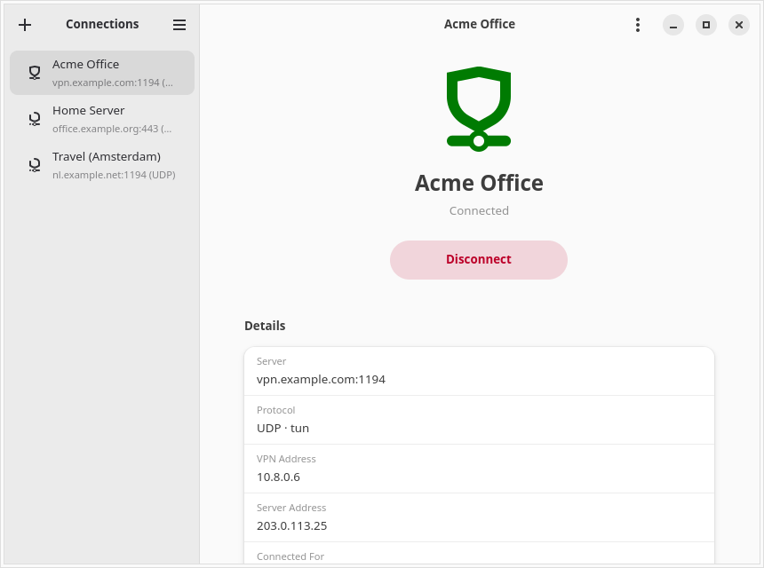
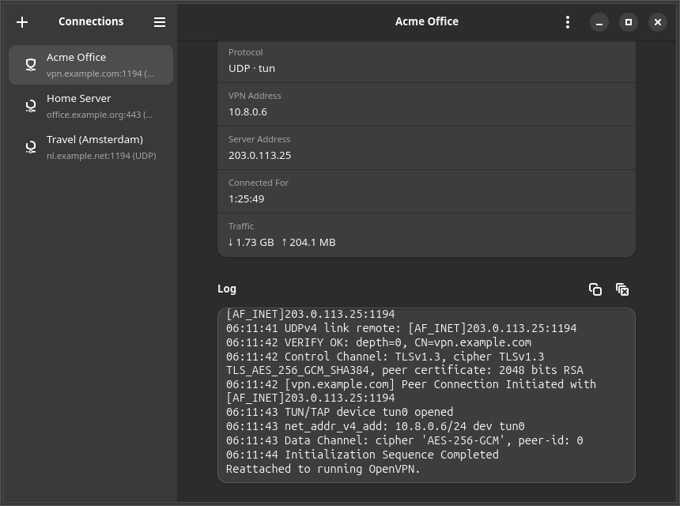

# OpenVPN Client for Linux: a GUI for .ovpn files

[](https://github.com/H3lel/Ovpn-Client/releases/latest)
[](LICENSE)


**OpenVPN Client is a free, open-source desktop app for connecting to OpenVPN servers on Linux.** You import an `.ovpn` or `.conf` file from your VPN provider, company or router, then connect with one click. No terminal is needed. It's a native GNOME app built with GTK 4 and libadwaita, works on Ubuntu and other Linux desktops, and can save your VPN password in GNOME Keyring.



**[Download the latest release](https://github.com/H3lel/Ovpn-Client/releases/latest)**: [Install](#install) · [Features](#features) · [FAQ](#faq) · [Compared to other OpenVPN apps](#compared-to-other-openvpn-clients-on-linux)

## Features

- **Import `.ovpn` / `.conf` files** with the + button, Ctrl+O, drag and drop, or "Open With" in Files. Certificate and key files the config points to (`ca`, `cert`, `key`, `tls-auth`, `tls-crypt`, `pkcs12`, …) are copied along with it, and inline `<ca>`/`<cert>`/`<key>` blocks work too.
- **One-click connect and disconnect.** OpenVPN runs as root through `pkexec`, so you get the standard system password prompt.
- **Sign-in prompts** for username/password, private-key passwords, proxy credentials and static challenges (OTP / 2FA codes). Answers go straight to OpenVPN.
- **Save Password** keeps the password in your login keyring (GNOME Keyring via libsecret), never in the app's own files. Saved passwords are filled in automatically. If the server rejects one, it is deleted and you're asked again. **Forget Saved Password** in the connection menu removes it, and it appears as "OpenVPN Client: <name>" in the Passwords and Keys app.
- **Fixes "connected but no internet" automatically:** some servers push a `route-gateway` outside the subnet they assign. Linux then refuses the routes, and with `redirect-gateway` you end up with no internet at all (state `ROUTE_ERROR`). The app detects this, picks an address inside the VPN subnet (on a tun device the gateway is only a label), remembers it for that connection, and reconnects once.
- **Older servers work as-is:** configs with a legacy `cipher` (e.g. `AES-256-CBC`) and no `data-ciphers` get that cipher offered too. OpenVPN 2.6+ would otherwise offer only modern ciphers, and servers that only speak the old one drop the connection mid-handshake ("Connection reset" loops).
- **Live status**: connection stage, VPN and server addresses, how long you've been connected, traffic counters, and a live log you can copy.
- **Web sign-in**: SAML / `WEB_AUTH` servers open your browser automatically.
- **Stays connected after you close the window** if you choose to. Reopening the app reattaches to the running tunnel.
- **Several profiles** can be connected at the same time.
- **Light and dark mode**, following your system accent color.



## Install

### From a release (recommended)

Download `ovpn-client-<version>-linux-x64.tar.gz` from [Releases](https://github.com/H3lel/Ovpn-Client/releases/latest). It's self-contained, so .NET doesn't need to be installed.

```bash
sudo apt install openvpn
tar xzf ovpn-client-*-linux-x64.tar.gz
cd ovpn-client-*-linux-x64
./install.sh
```

Then open **OpenVPN Client** from the app grid, or run `ovpn-client`. To remove it, run `./install.sh --uninstall`.

**Requirements:** a 64-bit Linux desktop with GTK 4 and libadwaita 1.5 or newer, OpenVPN 2.6 or newer (2.7 recommended), and polkit (`pkexec`). Ubuntu 24.04 and newer with GNOME has everything except `openvpn`. On Fedora, install OpenVPN with `sudo dnf install openvpn`, and on Arch with `sudo pacman -S openvpn`. It's developed and tested on Ubuntu.

### Build from source

```bash
sudo apt install openvpn dotnet-sdk-10.0
git clone https://github.com/H3lel/Ovpn-Client.git
cd Ovpn-Client
./install.sh          # build and install for your user
# or just run it:
dotnet run
```

## How to use

1. Get an `.ovpn` file from your VPN provider, your company's IT, or your router (pfSense, OPNsense, OpenWrt, ASUS, Synology, etc.).
2. Open OpenVPN Client and click **+**, or drag the file onto the window.
3. Click **Connect**, approve the system password prompt, and enter your VPN username and password if the server asks. Turn on **Save Password** to skip that next time.

## Compared to other OpenVPN clients on Linux

| | OpenVPN Client (this app) | NetworkManager OpenVPN plugin | `openvpn` / `openvpn3` CLI |
| --- | --- | --- | --- |
| Graphical interface | ✅ Standalone GNOME app | ✅ In system settings | ❌ Terminal only |
| Uses your `.ovpn` file unchanged | ✅ OpenVPN reads it directly | ⚠️ Converted to NetworkManager settings, so some options are not supported | ✅ |
| Live log and traffic counters | ✅ | ❌ (journal only) | ✅ In the terminal |
| Fixes bad pushed gateways and legacy ciphers | ✅ Automatically | ❌ | ❌ Manual flags |
| Saved passwords | ✅ GNOME Keyring | ✅ | ❌ |

## FAQ

### How do I use an .ovpn file on Linux with a GUI?
Install OpenVPN Client, click **+** (or drag the `.ovpn` file onto the window), then click **Connect**. The file and the certificates it references are copied into the app, so you can delete the original download.

### Is this an official OpenVPN app?
No. It is an independent open-source project. It uses the official `openvpn` program from your distribution to make the connection, and adds a graphical interface on top. OpenVPN is a registered trademark of OpenVPN Inc.

### Is this a VPN service?
No. It's a client, so you need a VPN server or provider that gives you an OpenVPN config (`.ovpn`). Many commercial VPN providers, companies and home routers do.

### Does it work on Ubuntu, Fedora, Debian or Arch?
It's built and tested on Ubuntu (24.04 and newer). Any 64-bit distribution with GTK 4, libadwaita 1.5+, polkit and OpenVPN 2.6+ should work, such as Fedora 40+, Debian 13 and Arch.

### Where is my VPN password stored?
Only if you turn on **Save Password**, and then in your login keyring (GNOME Keyring / Secret Service), the same place your browser and Wi-Fi passwords are kept. It's never written to the app's own files. Your username is remembered in the profile list.

### Why does OpenVPN say "connected" but there's no internet?
Often the server pushes a gateway that lies outside the address range it gives you, so Linux refuses the routes (`ROUTE_ERROR`). With `redirect-gateway` the normal internet route has already been removed, so nothing loads. This app detects that and reconnects with a valid gateway automatically.

### Why does my connection keep resetting during the handshake?
The server probably only supports an old cipher like `AES-256-CBC`, while OpenVPN 2.6+ only offers modern ones by default. If your config has a `cipher` line, the app also offers that cipher, which fixes the "Connection reset" loop.

### Does the VPN stay on when I close the window?
If you choose **Keep Connected** when closing. OpenVPN keeps running in the background, and the next time you open the app it reattaches and shows the live status again.

### Do I need to type my system password every time?
Yes, by default, because OpenVPN needs root to create the tunnel. See [Notes](#notes) for how to allow it without a prompt using a polkit rule.

## How it works

```
GTK app (your user) ──unix socket──▶ openvpn (root, started with pkexec)
     ▲   management protocol: state, bytecount, log, password, signal
```

- When you connect, the app runs `setsid pkexec openvpn --config … --management <socket> unix --management-client-user $USER --management-hold --management-query-passwords --auth-retry interact`.
- OpenVPN creates the management socket in `$XDG_RUNTIME_DIR/ovpn-client/` and accepts connections on it only from your user.
- Everything else goes over that socket: status, credential prompts, traffic counters, the log, and stopping the connection (`signal SIGTERM`). The app never needs root after the initial `pkexec`.
- `setsid` puts OpenVPN in its own session, so the tunnel survives the app closing. The socket path is fixed per profile, so the next launch finds it and reattaches.

Where things are stored:

| What | Where |
| --- | --- |
| Imported profiles | `~/.local/share/ovpn-client/profiles/<id>/` |
| Profile list | `~/.local/share/ovpn-client/profiles.json` |
| Sockets and OpenVPN logs | `$XDG_RUNTIME_DIR/ovpn-client/` |

## Notes

- **DNS:** pushed DNS servers are applied by OpenVPN 2.7's built-in `dns-updown` handling, which works with systemd-resolved on Ubuntu. On older OpenVPN versions, add an `up`/`down` script such as `update-systemd-resolved` to the config.
- **Password every time:** `pkexec` asks for your password on each connect. If you want to avoid that, add a polkit rule for `/usr/sbin/openvpn`. That effectively gives your user root-level VPN control, so decide whether you're comfortable with that.
- **Configs that set their own `management` option** will clash with the app's, so remove that line from the config.

## Development

`src/` layout:

| File | Purpose |
| --- | --- |
| `Program.cs` | `Adw.Application` setup, single instance, open-file handling |
| `MainWindow.cs` | Window, sidebar, import, drag and drop, close confirmation, reattach |
| `ProfilePage.cs` | Detail page: status, connect button, details, log |
| `VpnSession.cs` | Starts OpenVPN and speaks the management protocol |
| `CredentialsDialog.cs`, `Dialogs.cs` | Awaitable `Adw.AlertDialog` helpers |
| `OvpnConfig.cs` | Minimal `.ovpn` reader (server summary, referenced files) |
| `ProfileStore.cs` | Profile import and storage |
| `Keyring.cs` | Saved passwords via libsecret |
| `Native.cs` | `GdkFileList` → paths, for drag and drop |

Environment variables for testing:

- `OVPN_CLIENT_NO_PKEXEC=1` runs OpenVPN as your own user, without `pkexec`. This is useful with `dev null` test configs.
- `OVPN_CLIENT_OPENVPN=/path/to/openvpn` uses a different OpenVPN binary.

To build a single native binary (requires `clang`):

```bash
dotnet publish -c Release -r linux-x64 -p:PublishAot=true
```

## License

MIT, see [LICENSE](LICENSE).
